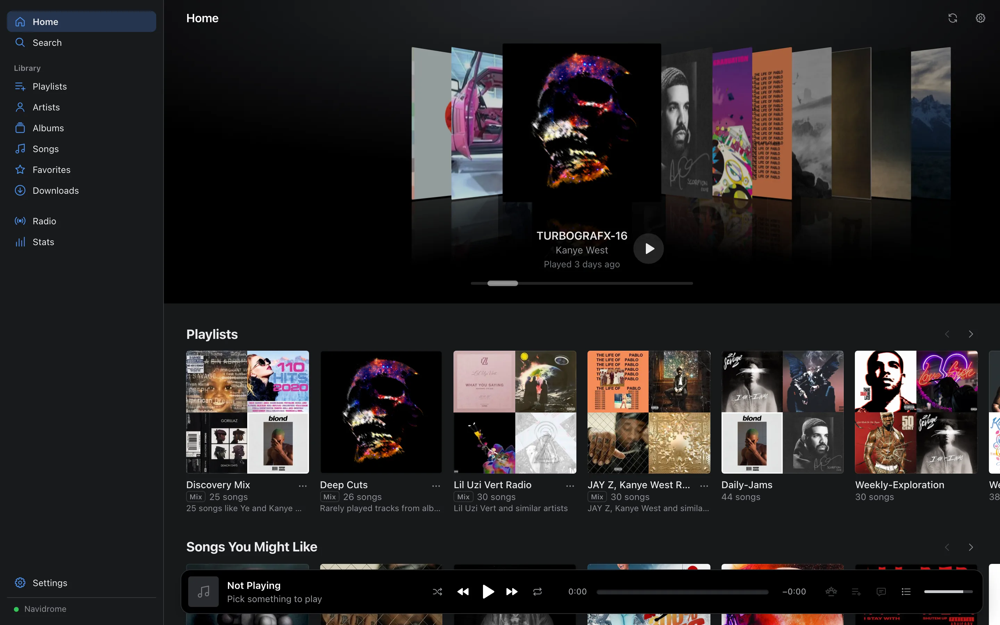
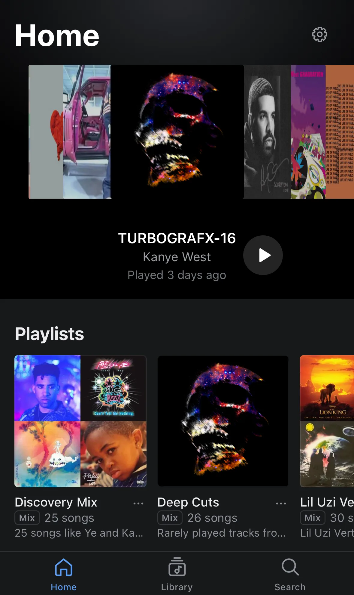
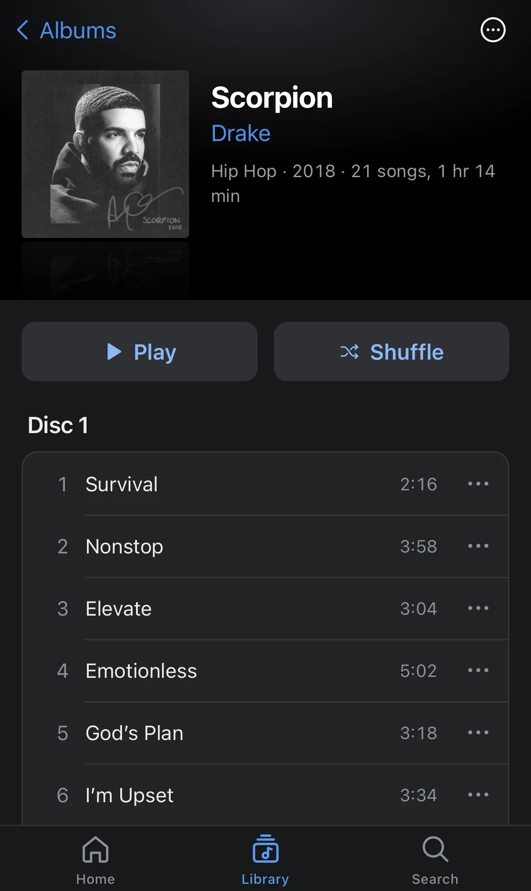
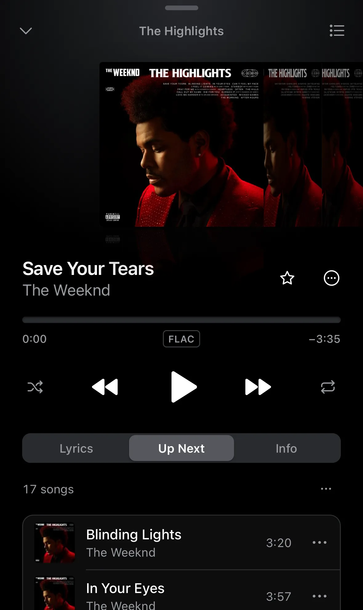

# RustySound

A music player for your Navidrome or Subsonic server. Mac, iPhone, Windows, Linux, Android and the web.

**[Try it in your browser](https://rustysound-demo.adarcher.app)** · **[Download](https://github.com/AD-Archer/RustySound/releases/latest)**

<p align="center">
  
</p>

<p align="center">
  
  &nbsp;
  
  &nbsp;
  
</p>

## Install

| | One click | Or one command |
| --- | --- | --- |
| **Mac** | [Download .dmg](https://github.com/AD-Archer/RustySound/releases/latest/download/Rustysound.dmg) | Homebrew, below |
| **iPhone** | [Add to AltStore](https://stikstore.app/altdirect/?url=https://ad-archer.github.io/packages/source.json) | |
| **Windows** | [Download installer](https://github.com/AD-Archer/RustySound/releases/latest) | Scoop, below |
| **Linux** | | Flatpak, below |
| **Android** | [Download .apk](https://github.com/AD-Archer/RustySound/releases/latest/download/app-debug.apk) | |
| **Your own server** | | Docker, below |

**Mac**

```bash
brew trust ad-archer/tap && brew install --cask ad-archer/tap/rustysound && xattr -dr com.apple.quarantine /Applications/Rustysound.app
```

**Windows**

```powershell
scoop bucket add ad-archer https://github.com/ad-archer/scoop; scoop install ad-archer/rustysound
```

**Linux**

```bash
flatpak remote-add --if-not-exists --user adarcher-rustysound https://ad-archer.github.io/packages/rustysound.flatpakrepo && flatpak install --user adarcher-rustysound app.adarcher.rustysound//stable
```

**Docker** (opens at `http://localhost:8080`)

```bash
docker run -d -p 8080:80 --name rustysound ghcr.io/ad-archer/rustysound:latest
```

Then open RustySound and add your server. Updating, the macOS "app is damaged" warning and other fixes are in [docs/INSTALL.md](docs/INSTALL.md).

## More

- [Building and testing RustySound](docs/DEVELOPMENT.md)
- License: [GPL-3.0-or-later](LICENSE). Built with [Dioxus](https://dioxuslabs.com/).
